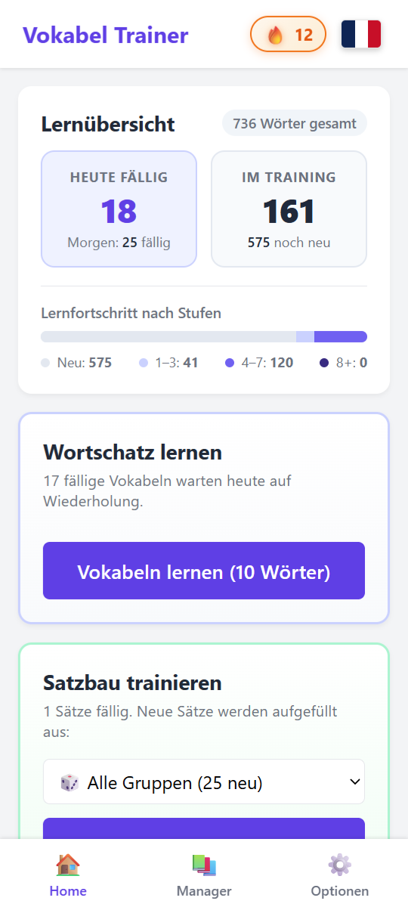
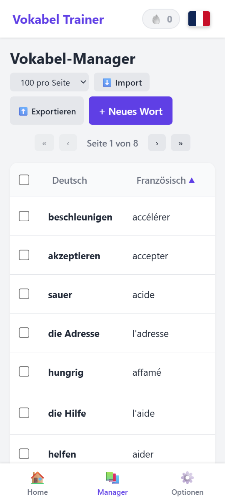
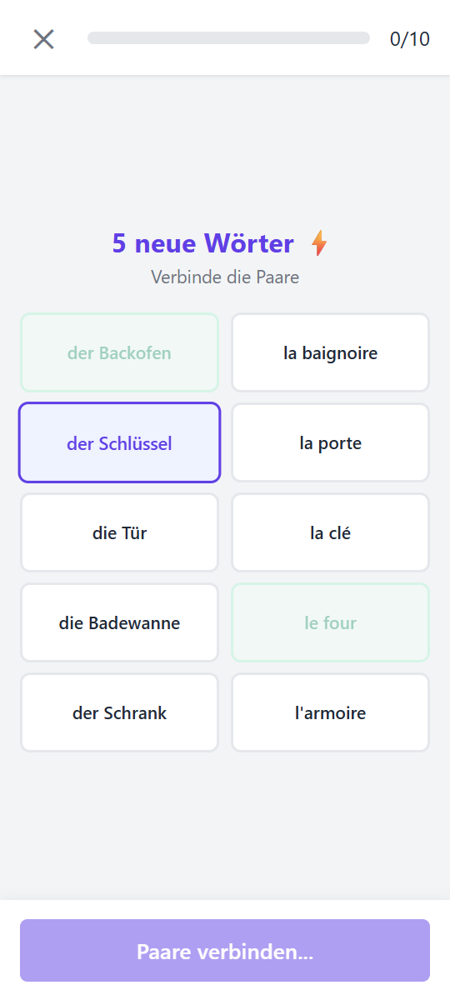
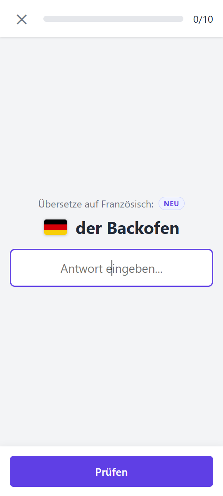
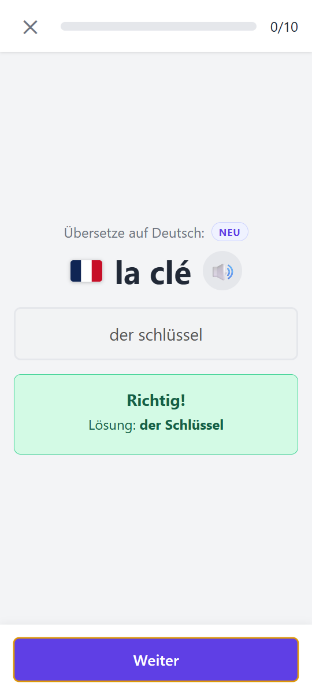

# 🧪 Vokabel Trainer (Testversion / Preview)

Ein schlanker Vokabeltrainer mit Spaced Repetition, Offline-Funktion und ohne unnötigen Schnickschnack.

> ### ⚠️ WICHTIGER HINWEIS: DIES IST EINE TESTVERSION!
>
> - **Nutzung auf eigene Gefahr:** Diese Version dient rein zu Test- und Entwicklungszwecken.
> - **Keine Datengarantie:** Die Datenspeicherung im Browser funktioniert grundsätzlich stabil. Dennoch können durch Fehler oder experimentelle Updates mühsam angelegte Vokabeln beschädigt werden oder verloren gehen. **Erstelle regelmäßig Backups über die Export-Funktion!**
> - **Ständige Änderungen:** Features können sich jederzeit ohne Vorwarnung ändern, unvollständig sein oder temporär fehlerhaft reagieren.
> - **Finale Version:** Eine saubere, stabile Version wird nach Abschluss aller Tests in einem separaten Repository veröffentlicht: **`Vokabel-Trainer`**.

---

👉 **[Hier klicken, um die Testversion im Browser auszuprobieren](https://DEIN-NUTZERNAME.github.io/vokabel-trainer-test/)**

*PWA-fähig: Du kannst die Seite einfach zum Startbildschirm hinzufügen.*

---

## 📱 Screenshots

<div align="center">
  
  
  
  
  
</div>

---

## 💡 Warum dieses Projekt?

Moderne Sprachlern-Apps sind häufig mit Funktionen überladen, die vom eigentlichen Lernen ablenken:

- Endlose, nervige Animationen und Ladebalken
- Künstliche Wartezeiten oder künstlicher Zeitdruck
- Unnötige Punkte-, Diamanten- oder XP-Systeme
- Aufdringliche Werbung oder teure Abonnements

Dieser Vokabeltrainer soll dir dabei helfen, Vokabeln entspannt und effektiv zu lernen – ganz ohne störende Extras oder künstlichen Druck.

---

## ✨ Weitere Highlights

- 🔒 **100 % lokal & kein Konto:** Du musst dich nirgendwo registrieren. Alle Daten liegen in der internen Datenbank deines Browsers (`IndexedDB`). Deine Daten gehören dir.
- 📶 **Offline & PWA:** Einmal aufgerufen, funktioniert die App dank Service Worker komplett offline (z. B. im Flugmodus oder unterwegs).
- 🌍 **Mehrere Sprachen parallel:** Lege beliebig viele Sprachen an (z. B. Englisch, Spanisch, Französisch). Jede Sprache hat eine komplett eigenständige Datenbank und ihren eigenen Fortschritt.
- 🔥 **Täglicher Streak:** Ein Streakzähler pro Sprache motiviert dich, jeden Tag zumindest eine kurze Runde zu absolvieren (inklusive Rettungsmodus, falls du mal einen Tag verpasst hast).
- 🔊 **Sprachausgabe (Text-to-Speech):**
  - Du kannst einstellen, ob die Fremdsprache beim Erscheinen automatisch vorgelesen wird oder nur per Klick auf das Lautsprecher-Symbol.
  - **Offline-Sprachausgabe:** Kann in den Einstellungen aktiviert werden. Voraussetzung: Im Betriebssystem deines Geräts muss ein entsprechendes Sprachpaket installiert sein. Da die Qualität der Stimmen je nach Gerät stark variiert, solltest du das für deine Sprache erst ausprobieren.
- 🌐 **Sprachbasis & App-Übersetzungen:** Aktuell ist die Benutzeroberfläche auf **Deutsch** und dient als feste Ausgangssprache, aus der du in andere Sprachen lernst. Eine vollständige Mehrsprachigkeit (andere App-Sprachen und andere Ausgangssprachen) ist bereits in Vorbereitung und wird zu einem späteren Zeitpunkt ergänzt.

---

## 🚀 Erste Schritte: Vokabeln anlegen

Beim ersten Start ist die App komplett leer. Du kannst Vokabeln auf zwei Wegen hinzufügen:

### Weg 1: Einzeln eingeben (einfach & flexibel)

Im Grunde musst du einfach nur das Wort und dessen Übersetzung eingeben – alles andere ist rein optional. Die App bietet dir aber clevere Zusatzfunktionen:

- **Artikel in eckige Klammern `[...]`:**  
  Schreibst du den Artikel in eckige Klammern (z. B. `[die] Katze` oder `[the] cat`), erkennt die App ihn automatisch als Artikel.  
  *Der große Vorteil beim Lernen:* Du kannst die Antwort später **mit oder ohne Artikel** eintippen (also `Katze` oder `die Katze`) – beides wird als richtig gewertet!
- **Bedeutungen unterscheiden mit `(...)`:**  
  Runde Klammern sind optional und dienen dazu, gleich geschriebene Wörter zu unterscheiden (z. B. `Bank (Finanzen)` vs. `Bank (Park)`).
- **Mehrere Übersetzungen / Synonyme:**  
  Gibt es mehrere Übersetzungen oder Synonyme, trennst du sie einfach mit einem Semikolon `;` (z. B. `Geldinstitut; Bank`).

### Weg 2: Ganze Listen per JSON importieren

Du kannst bestehende Vokabellisten oder Quellen aus dem Internet zum Beispiel ganz einfach von einer KI in das passende Format bringen lassen.

#### 📋 Das Import-Format:

```json
[
  {
    "german": "[die] Katze",
    "foreign": "[the] cat",
    "group": "Tiere"
  },
  {
    "german": "[die] Bank (Finanzen); [das] Geldinstitut",
    "foreign": "[the] bank",
    "group": "Test am Montag"
  },
  {
    "german": "Hund",
    "foreign": "dog"
  }
]
```

> **Hinweis zu Gruppen:**  
> Das Feld `"group"` ist optional. Es ist aber extrem praktisch, wenn du größere Listen importierst oder Themen bündeln möchtest (z. B. `"Haus"`, `"Reise"`) oder dir gezielt eine Gruppe wie `"Test am Montag"` anlegst. Über den Modus **„Gezielt üben“** kannst du solche Gruppen separat wiederholen.

Speichere die fertige Liste als `.json`-Datei und importiere sie anschließend im Manager über **⬇️ Import**.

---

## 🧠 Wie gelernt wird: Das Spaced Repetition System (SRS)

Die App basiert auf dem wissenschaftlich bewährten **Spaced Repetition System** (angelehnt an das klassische Karteikasten-Prinzip von Sebastian Leitner):

1. **Auf- und Abstieg:**
   - Weißt du eine Vokabel richtig, steigt sie eine Stufe auf.
   - Machst du einen Fehler, fällt sie wieder zurück.
2. **Dynamische Intervalle:**
   - Wörter auf Stufe 1 werden schnell wiederholt (z. B. nach 1 Tag).
   - Wörter auf höheren Stufen werden in immer größeren Abständen abgefragt (nach Wochen oder Monaten).
3. **Smarte Lastverteilung:**
   - Die Fälligkeiten werden so berechnet, dass du an keinem Tag von Bergen an Wiederholungen erschlagen wirst, sondern dein tägliches Pensum ausgeglichen bleibt.

---

## 🛠️ Feedback

Falls dir Fehler auffallen oder du Ideen hast, erstelle gerne ein Issue im Repository!

*Sobald die Testphase beendet ist, wird die saubere, finale Version im Repository `Vokabel-Trainer` bereitgestellt.*